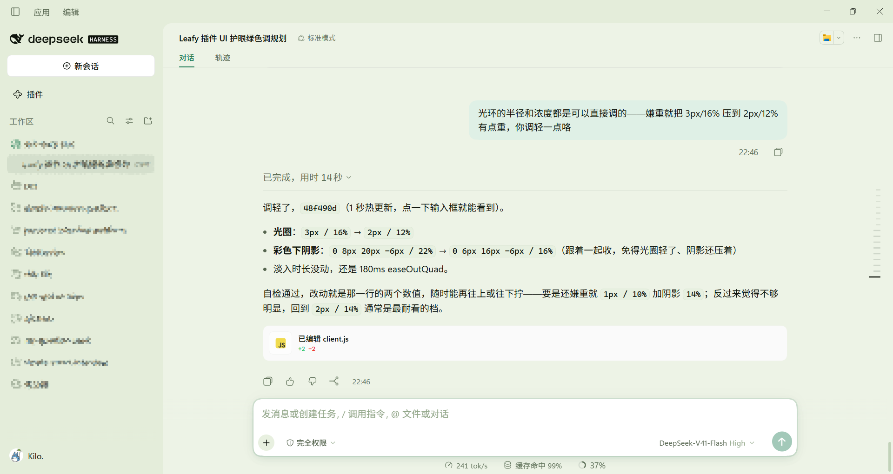

# dsh-leafy-skin

An eye-friendly green skin: a leafy palette layered over the official DSH web GUI theme, in a
light emerald and a dark mint variant.

> I wanted the effect of a Minecraft resource pack.

**English** | [中文](README.zh.md)

## Screenshot



## Features

- **Layered greens** — a mist-green canvas, raised panels, and a deeper sidebar, with emerald
  accents in light mode and mint in dark, instead of one flat wash of green.
- **Comfortable by construction** — no pure white or pure black, a single green hue family, and
  all body text at WCAG AA (≥ 4.5:1).
- **Texture** — softer corner radii, green-tinted diffuse shadows, low-contrast hairlines, and
  glassy menu surfaces.
- **Details** — mint text selection, Inter / Noto Sans SC / Cascadia Code font stacks, slim
  scrollbars, and restrained hover and menu motion.
- **Tunable** — the palette is one commented table, a self-check script guards contrast, and the
  style layer has a single on/off switch.

## Install

```
dsh plugin --profile web add dsh-leafy-skin
```

Restart DSH once afterwards so the profile recomposes. After that, colour edits only need a page
refresh (client changes hot-reload within about a second).

## Usage

Install the plugin and load the app. The skin layers itself over the active theme, so light, dark,
and follow-system each pick up their own variant automatically.

## Customize

- **Colours** — the `TOKENS` table in `lib/client.js`, grouped and commented by area.
- **Radii, shadows, fonts, motion** — the same file, plus the small style layer below it.
- **Palette only** — set `ENABLE_CSS_LAYER` to `false` in `lib/client.js` to drop the style layer
  entirely.
- **Check your work** — `node tools/check-palette.mjs` validates token shape, text and syntax
  contrast, and the style layer's three constraints.

## Uninstall

Any one of these, then restart DSH:

1. Comment out the `insert` entry in `cordis.patch.yml`;
2. Drop `dsh-leafy-skin` from `dsh.profile.bundles` in `~/.dsh/profiles/<profile>/package.json`;
3. Run `dsh plugin --profile web remove dsh-leafy-skin`.

## Known limitations

- The native window title bar belongs to the DSH desktop shell, not to this plugin, so it stays
  DSH grey for the instant before the page paints.
- Real see-through glass is impossible on Windows — the sidebar depth and translucent menus are
  colour layering, not blur through the window.
- Components hard-code font sizes and layout in hashed CSS modules, so this skin deliberately
  leaves them alone.

## Changelog

See [CHANGELOG.md](CHANGELOG.md)

## Contributing

Issues are welcome: bug reports, colour suggestions, screenshots of anything that looks off.

**Pull requests are not accepted** — this is a personal skin, and reviewing patches would cost more
than it returns. Please open an issue instead.

## License

[MIT](LICENSE)
